# IoT Temperature and Humidity Monitoring System

An end-to-end Internet of Things (IoT) solution featuring an ESP32 microcontroller, DHT11 sensor, I2C OLED display, Eclipse Mosquitto MQTT broker, and a lightweight real-time web dashboard running in Docker containers.

---

## Table of Contents
- [1. The Story of IoT: Why Smart Monitoring Matters](#1-the-story-of-iot-why-smart-monitoring-matters)
  - [1.1 From Manual Checks to Automated Sensing](#11-from-manual-checks-to-automated-sensing)
  - [1.2 This Project as a Real-World IoT Implementation](#12-this-project-as-a-real-world-iot-implementation)
- [2. System Architecture](#2-system-architecture)
  - [2.1 Conceptual System Architecture](#21-conceptual-system-architecture)
  - [2.2 Hardware Wiring and Pinout Architecture](#22-hardware-wiring-and-pinout-architecture)
  - [2.3 End-to-End Data Pipeline](#23-end-to-end-data-pipeline)
- [3. Hardware and Software Stack](#3-hardware-and-software-stack)
  - [3.1 Hardware Components](#31-hardware-components)
  - [3.2 Software and Protocols](#32-software-and-protocols)
- [4. Implementation Walkthrough and Visual Evidence](#4-implementation-walkthrough-and-visual-evidence)
  - [4.1 Complete Working Prototype Overview](#41-complete-working-prototype-overview)
  - [4.2 Backend Deployment with Docker Compose](#42-backend-deployment-with-docker-compose)
  - [4.3 MQTT Broker Verification with MQTT Explorer](#43-mqtt-broker-verification-with-mqtt-explorer)
  - [4.4 Web Dashboard Initialization](#44-web-dashboard-initialization)
  - [4.5 Hardware Component Testing and Inspection](#45-hardware-component-testing-and-inspection)
  - [4.6 Wi-Fi and Broker Captive Portal Provisioning](#46-wi-fi-and-broker-captive-portal-provisioning)
  - [4.7 Telemetry Ingestion and Multi-Device Real-Time Monitoring](#47-telemetry-ingestion-and-multi-device-real-time-monitoring)
- [5. How to Run the Project](#5-how-to-run-the-project)
  - [5.1 Launching the Backend Server](#51-launching-the-backend-server)
  - [5.2 Flashing Firmware to ESP32](#52-flashing-firmware-to-esp32)
  - [5.3 Configuring Device via Web Portal](#53-configuring-device-via-web-portal)
- [6. Key Learnings and Future Enhancements](#6-key-learnings-and-future-enhancements)
  - [6.1 Summary of Achievements](#61-summary-of-achievements)
  - [6.2 Future Improvements](#62-future-improvements)

---

## 1. The Story of IoT: Why Smart Monitoring Matters

### 1.1 From Manual Checks to Automated Sensing
In the past, measuring physical conditions such as temperature and humidity required a person to walk physically to a specific location with an analog thermometer or digital meter, write down the numbers on a sheet of paper, and repeat this cycle multiple times a day.

Imagine running a greenhouse, a server rack room, a pharmaceutical storage area, or a poultry farm:
- **Delay in Information:** If the air conditioner fails in a server room at midnight, nobody knows until the morning when the servers have already overheated and crashed.
- **Human Error:** Manual logs can be missed, misread, or recorded at irregular intervals.
- **Lack of Scalability:** Monitoring ten rooms manually takes time; monitoring one hundred rooms manually is almost impossible.

The **Internet of Things (IoT)** changes this paradigm completely. By equipping everyday physical devices with sensors, microcontrollers, and wireless connectivity, we give physical environments the ability to **feel**, **think**, and **communicate**:
1. **Sensors** act as electronic senses, capturing physical metrics (heat, moisture) into electrical signals.
2. **Microcontrollers** act as the local brain, converting raw signals into digital numbers and packaging them into clean data formats.
3. **Wireless Networks (Wi-Fi)** act as the voice, transmitting information through the air without messy cables.
4. **Message Brokers (MQTT)** act as the postal sorting hub, receiving telemetry messages and delivering them instantly to subscribers without wasting network bandwidth.
5. **Dashboards** act as the eyes, allowing operators to monitor live conditions anytime and anywhere from a smartphone or laptop.

### 1.2 This Project as a Real-World IoT Implementation
This project is an authentic, practical realization of the IoT paradigm. Rather than simply connecting a sensor to a microcontroller to print values on a serial monitor, this system delivers an entire **end-to-end IoT lifecycle**:
- **Zero Hardcoded Credentials:** The device features a user-friendly Wi-Fi Captive Portal mode (SoftAP) so users can easily change Wi-Fi SSIDs, passwords, and MQTT server IP addresses from any phone without touching the C++ code.
- **Edge Visualization:** A compact 0.96-inch OLED screen mounted on the breadboard provides immediate on-site diagnostic feedback (connection mode, IP addresses, MQTT status, and live sensor values).
- **Lightweight Asynchronous Messaging:** An Eclipse Mosquitto broker runs inside a Docker container, routing telemetry updates published by the ESP32 to multiple clients in milliseconds.
- **WebSockets for Browser Streaming:** The browser dashboard connects directly to the MQTT broker over WebSockets (port 9001), streaming live sensor updates with zero polling lag.
- **Mobile & Desktop Support:** A responsive HTML5/JavaScript dashboard allows simultaneous monitoring across smartphones and laptops.

---

## 2. System Architecture

### 2.1 Conceptual System Architecture
The system is divided into three distinct operational domains: **Environment Site Edge**, **Environment Server**, and the **Dashboard IoT (Client Devices)**.

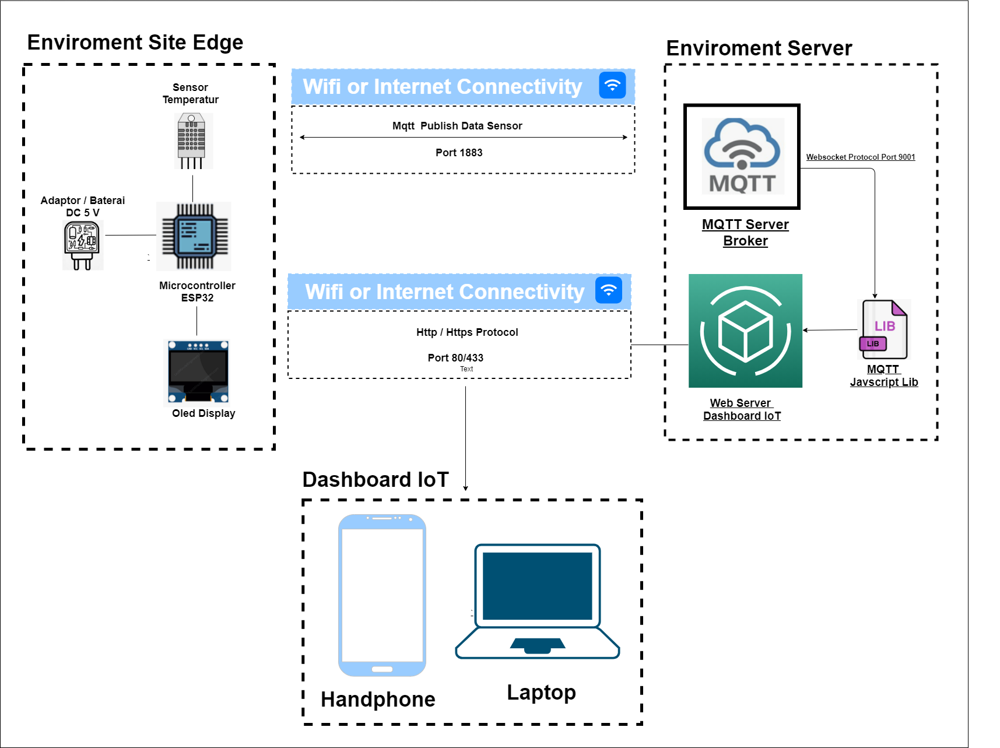

*Figure 2.1: System Architecture Concept ([design/aristektur.png](file:///d:/mygithub-research/iot/iot-monitor-temperatur/design/aristektur.png))*

The diagram above illustrates the complete data lifecycle:
1. **Environment Site Edge:**
   - Powered by a portable 5V DC battery power supply.
   - The **ESP32 Microcontroller** interfaces with the **DHT11 Temperature & Humidity Sensor** and an **OLED Display (SSD1306)**.
   - When connected to a Wi-Fi Access Point, the ESP32 publishes sensor measurements to the broker using the lightweight **MQTT protocol** over TCP port **1883**.
2. **Environment Server (Docker Containers):**
   - **MQTT Server Broker (Eclipse Mosquitto):** Listens on port **1883** for incoming sensor telemetry packets from the ESP32 and exposes port **9001** via WebSockets for web client connections.
   - **Web Server Dashboard IoT (Apache/PHP):** Serves the static dashboard web application (`index.html` and Paho MQTT JS library) over HTTP port **8080**.
3. **Dashboard IoT (End-User Devices):**
   - Laptops, PCs, and smartphones access the web page through their web browser (`http://<server-ip>:8080`).
   - The browser-side JavaScript runs the **Paho MQTT library**, connects to the MQTT broker via WebSockets (`ws://<server-ip>:9001`), subscribes to topic `v1/devices/me/telemetry`, and updates the UI instantly upon receiving new data.

---

### 2.2 Hardware Wiring and Pinout Architecture
To ensure high stability and correct signal routing between the microcontroller and peripherals, the hardware wiring follows the layout below:

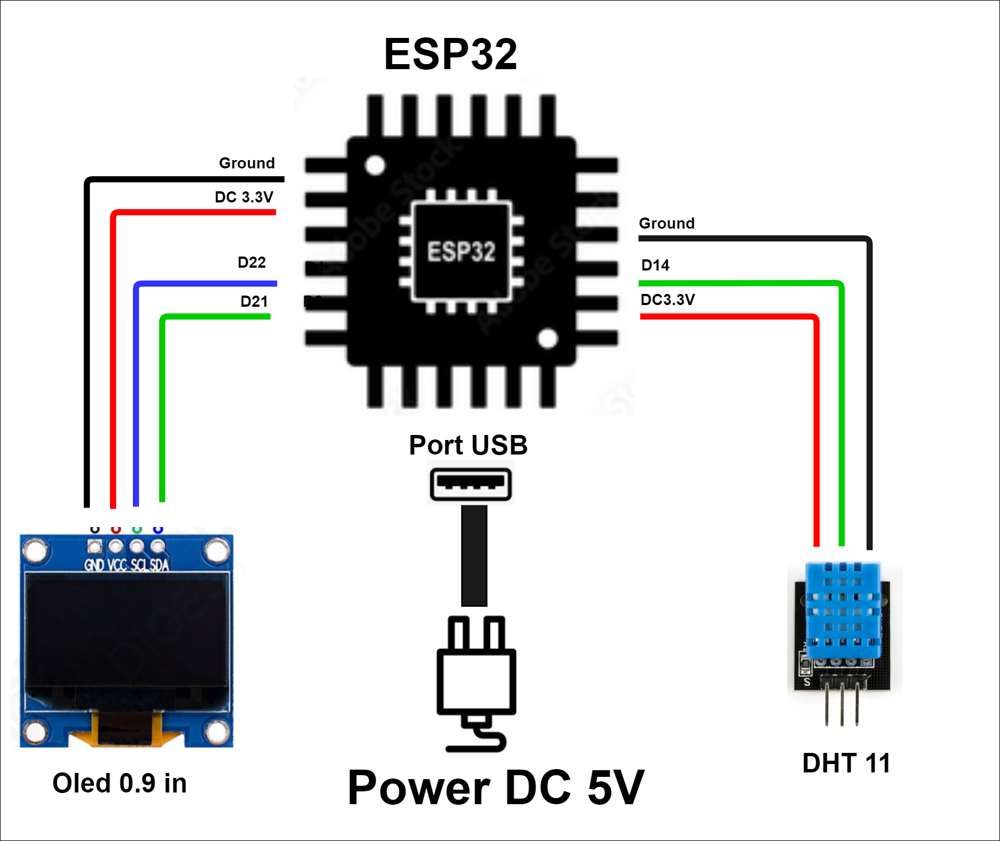

*Figure 2.2: Hardware Wiring and Pinout Architecture ([design/architecture-hadware.png](file:///d:/mygithub-research/iot/iot-monitor-temperatur/design/architecture-hadware.png))*

The hardware pin configuration is organized as follows:
- **Power Delivery:** A 5V DC supply (via micro-USB / power bank) powers the ESP32 development board. The ESP32 internal voltage regulator outputs regulated **3.3V DC** to supply the OLED display and DHT11 sensor module safely.
- **OLED Display (0.96 inch SSD1306 - I2C):**
  - `VCC` $\rightarrow$ ESP32 `3.3V`
  - `GND` $\rightarrow$ ESP32 `GND`
  - `SDA` $\rightarrow$ ESP32 `GPIO 21` (I2C Data line)
  - `SCL` $\rightarrow$ ESP32 `GPIO 22` (I2C Clock line)
- **DHT11 Sensor (Single-bus Data):**
  - `VCC` / `+` $\rightarrow$ ESP32 `3.3V`
  - `GND` / `-` $\rightarrow$ ESP32 `GND`
  - `DATA` / `OUT` / `S` $\rightarrow$ ESP32 `GPIO 4` (Configured in [main.ino](file:///d:/mygithub-research/iot/iot-monitor-temperatur/microcontroller-sensor-temperatur/main/main.ino#L18-L20))
- **Hardware Reset Button:**
  - ESP32 `GPIO 0` (Flash / Boot button) is configured with `INPUT_PULLUP`. Long-pressing for 3 seconds clears non-volatile Wi-Fi and MQTT credentials stored in flash memory, restoring the device to Access Point configuration mode.

---

### 2.3 End-to-End Data Pipeline
The sequence of data propagation through the entire stack operates as follows:

```
[ DHT11 Sensor ]
      |  (Analog physical moisture & heat -> Digital single-bus stream)
      v
[ ESP32 Microcontroller ]
      |  (Reads GPIO 4 every 2000 ms, formats JSON: {"temperature": xx.x, "humidity": xx.x})
      +---> [ Local OLED SSD1306 Display ] (Immediate edge reading)
      |
      |  (MQTT Publish over Wi-Fi / TCP Port 1883, Topic: "v1/devices/me/telemetry")
      v
[ Mosquitto MQTT Broker (Docker: 1883 & 9001) ]
      |
      |  (MQTT over WebSockets / Port 9001)
      v
[ Paho JavaScript Client (In Web Browser on Laptop & Phone) ]
      |
      v
[ Dynamic Responsive Web Dashboard (HTML5/CSS) ]
```

---

## 3. Hardware and Software Stack

### 3.1 Hardware Components
| Component | Quantity | Purpose in this Project |
| :--- | :--- | :--- |
| **ESP32 NodeMCU DevKit** | 1 | 32-bit dual-core Wi-Fi/Bluetooth SoC acting as the main IoT edge processing unit. |
| **DHT11 Sensor** | 1 | Digital sensor reading ambient temperature ($0\text{--}50\ ^\circ\text{C}$) and relative humidity ($20\text{--}90\ \% \text{RH}$). |
| **0.96" I2C OLED (SSD1306)** | 1 | Monochrome $128 \times 64$ display providing local system status, IP, SSID, and sensor values. |
| **ROBOT 5V Power Bank** | 1 | Portable DC battery providing untethered power to test standalone deployment. |
| **Solderless Breadboard** | 1 | Prototyping board for quick, reliable component interconnection. |
| **Jumper Wires (M-M / M-F)** | 1 Set | Connection wires for I2C and GPIO data routing. |

### 3.2 Software and Protocols
- **Firmware Engine:** C++ on Arduino Core for ESP32.
  - Libraries: `WiFi.h`, `PubSubClient.h` (MQTT), `ESPAsyncWebServer.h` (Captive Portal), `Preferences.h` (NVS storage), `DHT.h` (Adafruit DHT sensor), `Adafruit_GFX.h`, and `Adafruit_SSD1306.h` (I2C OLED).
- **MQTT Message Broker:** `eclipse-mosquitto:latest` deployed via Docker, listening on port 1883 (standard MQTT) and port 9001 (WebSockets).
- **Web Server:** `php:apache` deployed via Docker, serving the frontend files on port 8080.
- **Frontend Technologies:** HTML5, CSS3 responsive grid, vanilla JavaScript, and `mqttws31.min.js` (Paho MQTT WebSockets client).
- **Diagnostic Tools:** MQTT Explorer (cross-platform desktop MQTT testing client).

---

## 4. Implementation Walkthrough and Visual Evidence

### 4.1 Complete Working Prototype Overview
The physical IoT system was constructed and verified as a fully functional, autonomous monitoring station.

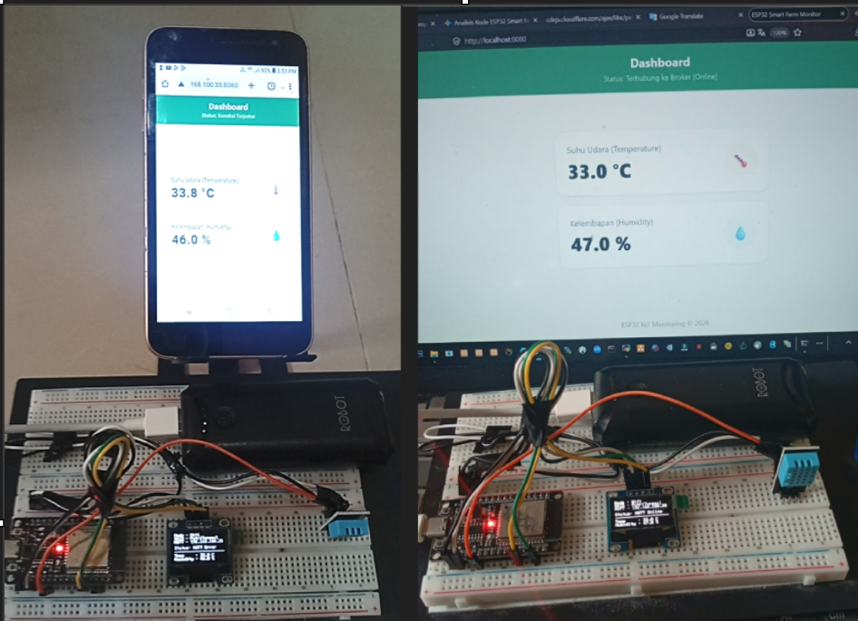

*Figure 4.1: Complete working IoT prototype running live with dual dashboard clients ([ss/0-main-prototype.png](file:///d:/mygithub-research/iot/iot-monitor-temperatur/ss/0-main-prototype.png))*

**Technical Analysis & Context:**
Figure 4.1 displays the entire operational system assembled on the prototyping workbench. In the foreground, the ESP32 microcontroller, OLED screen, and DHT11 sensor are interconnected on the breadboard, powered through a USB connection by the portable ROBOT power bank. 
- The OLED display confirms an active Wi-Fi link and live temperature and humidity readings.
- In the background, both a mobile smartphone (left) and a laptop web browser (right) run the real-time monitoring dashboard simultaneously.
- When temperature and humidity changes occur around the DHT11, both web screens and the physical OLED update in real-time, showing $33.0\text{--}33.8\ ^\circ\text{C}$ and $46\text{--}47\ \%$. This demonstrates that the entire loop—from physical sensing to wireless transmission to multi-client visualization—is working seamlessly.

---

### 4.2 Backend Deployment with Docker Compose
The backend architecture is containerized using Docker, allowing the entire server stack to start with a single command.

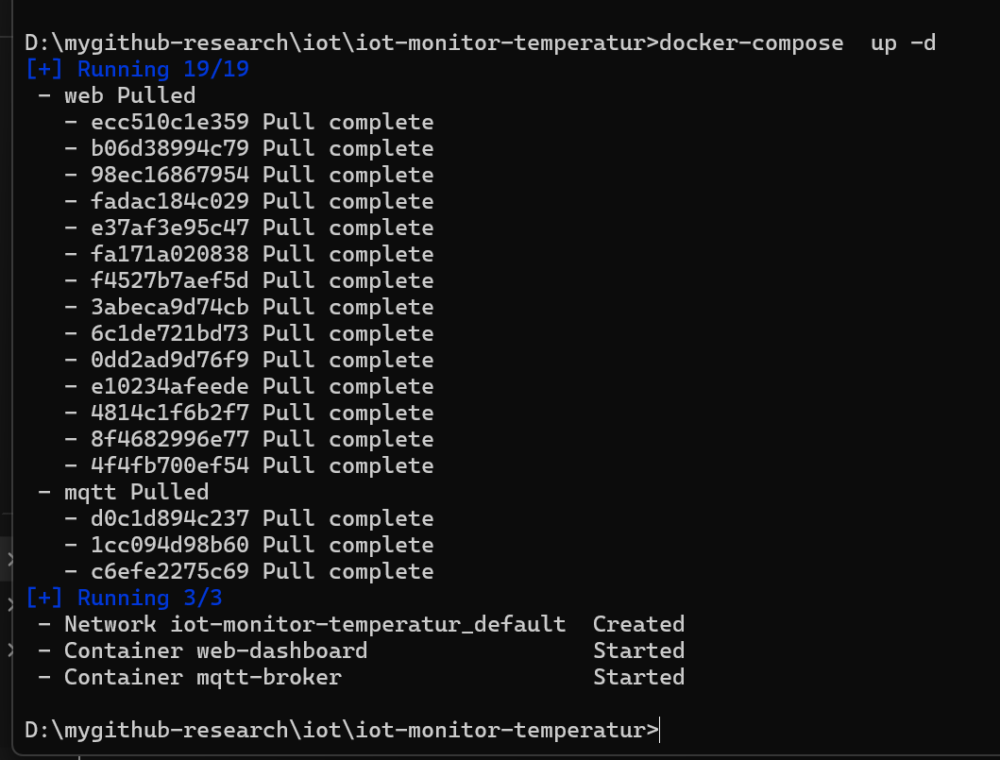

*Figure 4.2: Running `docker-compose up -d` in the project root ([ss/1-server-docker-deploy.png](file:///d:/mygithub-research/iot/iot-monitor-temperatur/ss/1-server-docker-deploy.png))*

**Technical Analysis & Context:**
Figure 4.2 shows the execution of the command `docker-compose up -d` in the terminal inside `d:\mygithub-research\iot\iot-monitor-temperatur`.
- Docker pulls the official Docker images: `php:apache` for serving the web dashboard and `eclipse-mosquitto:latest` for the messaging broker.
- Once downloaded, Docker automatically creates an isolated virtual bridge network named `iot-monitor-temperatur_default`.
- The two containers, `web-dashboard` and `mqtt-broker`, are started in detached mode. This guarantees an isolated, repeatable backend environment that runs consistently across Linux, macOS, and Windows without manual package installation.

---

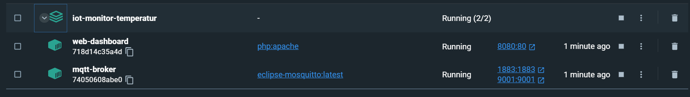

*Figure 4.3: Docker Desktop interface confirming containers are healthy and running ([ss/2-server-docker-deploy-up.png](file:///d:/mygithub-research/iot/iot-monitor-temperatur/ss/2-server-docker-deploy-up.png))*

**Technical Analysis & Context:**
Figure 4.3 shows the Docker Desktop graphical management dashboard. Both containers are in the `Running` state:
1. `web-dashboard` (container ID `718d14c35a4d`) has port mapping `8080:80`, binding port 8080 on the host computer to the internal Apache web server.
2. `mqtt-broker` (container ID `74050608abe0`) maps both port `1883:1883` (for TCP communication with the ESP32) and port `9001:9001` (for WebSockets communication with web browsers).
The volumes are mounted correctly, ensuring the Mosquitto configuration file ([mosquitto.conf](file:///d:/mygithub-research/iot/iot-monitor-temperatur/mosquitto/config/mosquitto.conf)) and web code ([html](file:///d:/mygithub-research/iot/iot-monitor-temperatur/html)) are dynamically loaded.

---

### 4.3 MQTT Broker Verification with MQTT Explorer
Before connecting the ESP32 microcontroller, the MQTT broker was independently tested using MQTT Explorer.

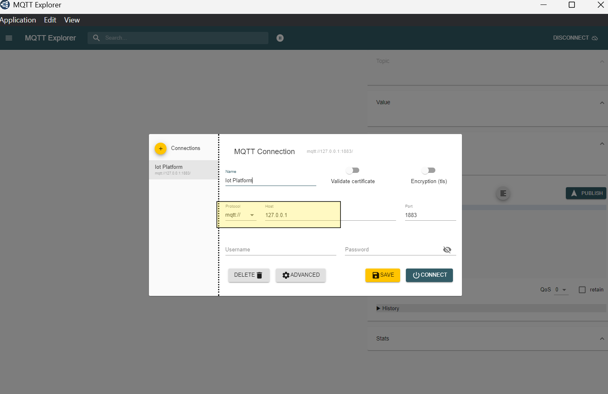

*Figure 4.4: Configuring connection parameters in MQTT Explorer ([ss/3-connect-mqtt-broker-via-mqtt-explore.png](file:///d:/mygithub-research/iot/iot-monitor-temperatur/ss/3-connect-mqtt-broker-via-mqtt-explore.png))*

**Technical Analysis & Context:**
Figure 4.4 shows the initial configuration dialog of MQTT Explorer:
- Connection Name: `IoT Platform`
- Protocol: `mqtt://`
- Host: `127.0.0.1` (localhost)
- Port: `1883`
Because our Mosquitto configuration has `allow_anonymous true` enabled in [mosquitto.conf](file:///d:/mygithub-research/iot/iot-monitor-temperatur/mosquitto/config/mosquitto.conf#L7), no username or password is required during local network testing, simplifying prototype validation.

---

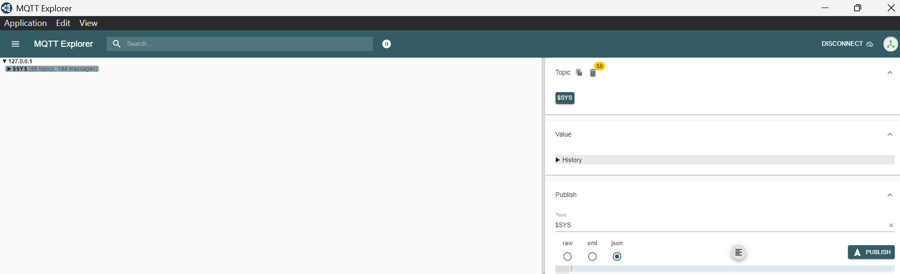

*Figure 4.5: Successful connection to Mosquitto showing system statistics ([ss/4-connect-mqtt-broker-via-mqtt-explore-2.png](file:///d:/mygithub-research/iot/iot-monitor-temperatur/ss/4-connect-mqtt-broker-via-mqtt-explore-2.png))*

**Technical Analysis & Context:**
Figure 4.5 confirms that MQTT Explorer has established a stable TCP connection with the containerized broker at `127.0.0.1`.
- The topic tree reveals the internal `$SYS` topic hierarchy (56 topics, 144 messages), which Mosquitto publishes automatically to report broker health, uptime, client connections, and message throughput.
- This verification step confirms that the Docker port forwarding rules (`1883:1883`) are working properly and that the broker is ready to accept publishers and subscribers.

---

### 4.4 Web Dashboard Initialization
Next, the web application frontend was tested through a standard web browser.

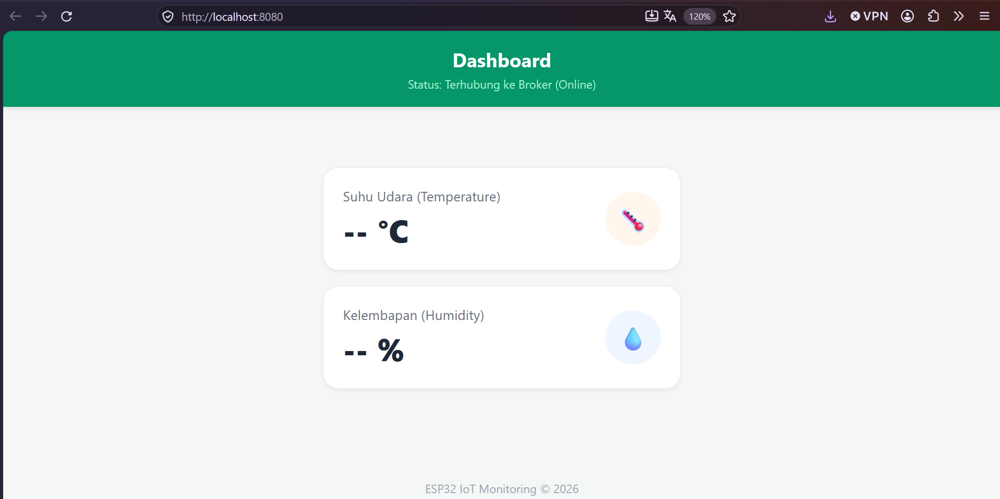

*Figure 4.6: Initial web dashboard accessed via localhost:8080 ([ss/5-checl-dashboard-iot.png](file:///d:/mygithub-research/iot/iot-monitor-temperatur/ss/5-checl-dashboard-iot.png))*

**Technical Analysis & Context:**
Figure 4.6 shows the web browser opening `http://localhost:8080`:
- The header displays `Status: Terhubung ke Broker (Online)` in light green text, indicating that the Paho JavaScript client successfully initiated and connected over WebSockets to `ws://localhost:9001`.
- The two cards for **Suhu Udara (Temperature)** and **Kelembapan (Humidity)** display placeholder symbols (`-- °C` and `-- %`).
- This confirms that the web application, styling, and WebSocket handshake are functioning as expected, and the dashboard is actively listening for the telemetry topic `v1/devices/me/telemetry`.

---

### 4.5 Hardware Component Testing and Inspection
Each individual hardware element was inspected and verified on the breadboard to prevent short circuits, loose connections, or communication faults.

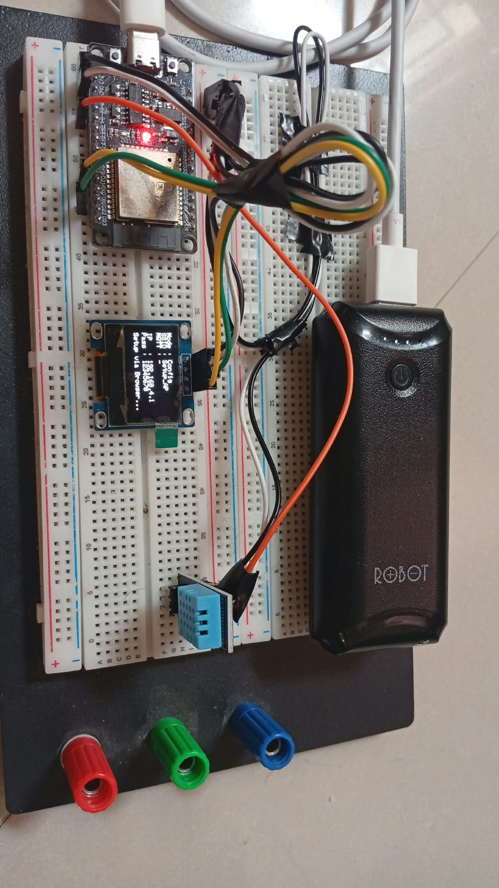

*Figure 4.7: Complete breadboard assembly before field deployment ([ss/6-test-all-component.jpeg](file:///d:/mygithub-research/iot/iot-monitor-temperatur/ss/6-test-all-component.jpeg))*

**Technical Analysis & Context:**
Figure 4.7 shows the complete breadboard assembly:
- The ESP32 is firmly seated on the breadboard with its USB port facing outwards for easy power and flashing.
- Jumper wires connect 3.3V and GND rails to the sensors and screen.
- The 0.96-inch OLED screen is operational and displays the default fallback configuration mode (`Mode : Config`, `IP : 192.168.4.1`), proving that the I2C bus and the microcontroller's initialization routine are working.
- The ROBOT power bank provides stable 5V current through the USB cable.

---

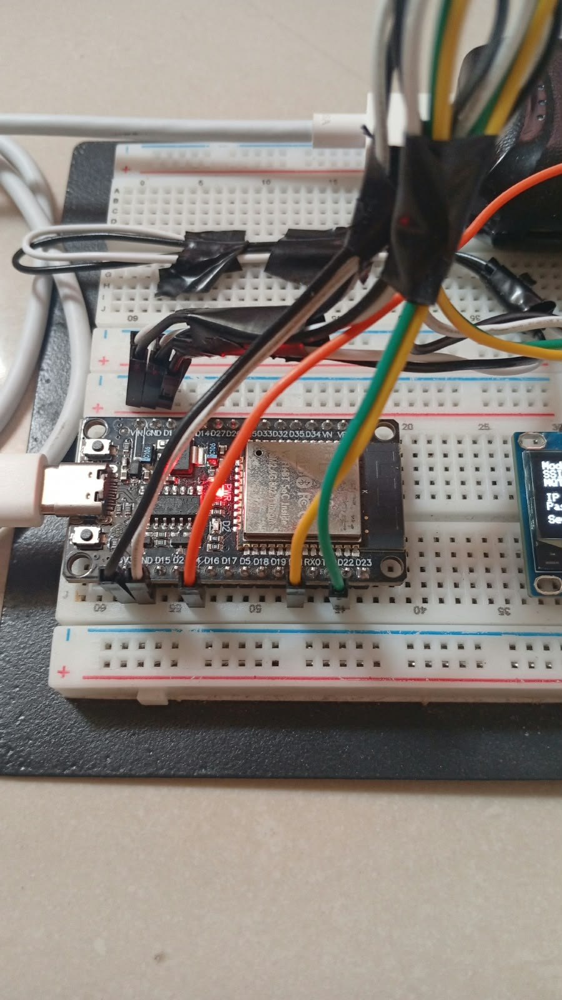

*Figure 4.8: Detailed view of the ESP32 NodeMCU board ([ss/7-test-component-espn32.jpeg](file:///d:/mygithub-research/iot/iot-monitor-temperatur/ss/7-test-component-espn32.jpeg))*

**Technical Analysis & Context:**
Figure 4.8 provides a close-up view of the ESP32 system-on-chip:
- The onboard red power LED (`PWR`) is brightly illuminated, confirming adequate input voltage.
- The wiring connections to the lower header pins are clearly visible:
  - `3V3` and `GND` for circuit power.
  - `GPIO 21` (green wire) and `GPIO 22` (yellow wire) for the I2C clock and data lines.
  - `GPIO 4` (orange wire) for the DHT11 digital data signal.
- The ESP32 Wi-Fi antenna trace at the top of the board is unobstructed to maximize wireless transmission range.

---

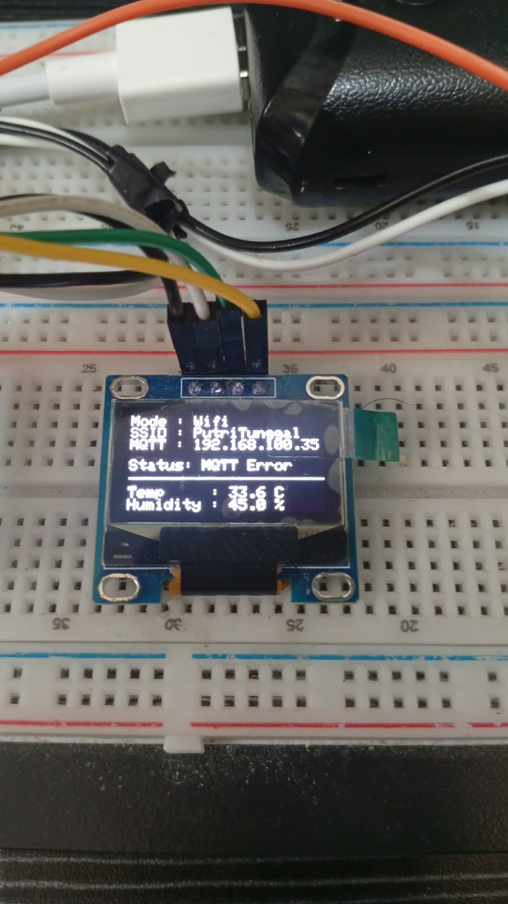

*Figure 4.9: 0.96-inch OLED screen displaying live operational status ([ss/8-test-component-oled.jpeg](file:///d:/mygithub-research/iot/iot-monitor-temperatur/ss/8-test-component-oled.jpeg))*

**Technical Analysis & Context:**
Figure 4.9 shows the $128 \times 64$ monochrome OLED module driven by the SSD1306 controller:
- The display is organized into structured diagnostic fields:
  - `Mode : Wifi`
  - `SSID : PutriTunggal`
  - `MQTT : 192.168.100.35`
  - `Status: MQTT Error` (captured during an initial connection attempt before the broker IP was reachable).
  - `Temp : 33.6 C`
  - `Humidity : 45.0 %`
- Having a local edge screen allows instant on-site diagnostics without having to connect a computer or read serial logs.

---

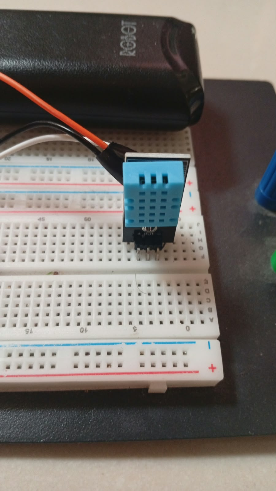

*Figure 4.10: DHT11 temperature and humidity sensor module ([ss/9-test-component-dht-11.jpeg](file:///d:/mygithub-research/iot/iot-monitor-temperatur/ss/9-test-component-dht-11.jpeg))*

**Technical Analysis & Context:**
Figure 4.10 shows the DHT11 sensor module:
- The module includes a blue perforated plastic housing containing a capacitive humidity sensing element and a high-precision NTC thermistor.
- A built-in resistor on the carrier PCB pulls up the data line, stabilizing single-bus digital communication with the ESP32.
- The 3-pin interface (`+` VCC, `-` GND, `OUT` Data) connects directly to the breadboard distribution rows.

---

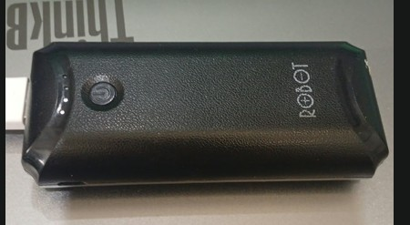

*Figure 4.11: ROBOT portable DC 5V power bank ([ss/11-test-component-batery.jpeg](file:///d:/mygithub-research/iot/iot-monitor-temperatur/ss/11-test-component-batery.jpeg))*

**Technical Analysis & Context:**
Figure 4.11 highlights the portable power source for the prototype:
- A compact ROBOT brand power bank with a 5V/1A USB output.
- Using a battery pack decouples the IoT device from desktop computer USB ports or AC wall adapters.
- This portability proves that the node can be deployed anywhere in a greenhouse, agricultural field, or warehouse within range of the local Wi-Fi network.

---

### 4.6 Wi-Fi and Broker Captive Portal Provisioning
Hardcoding Wi-Fi credentials (SSID and Password) into C++ firmware is bad practice because any change in network settings requires recompiling and reflashing the code. This project solves that problem with an **On-Demand Web Configuration Portal (Captive Portal)**.

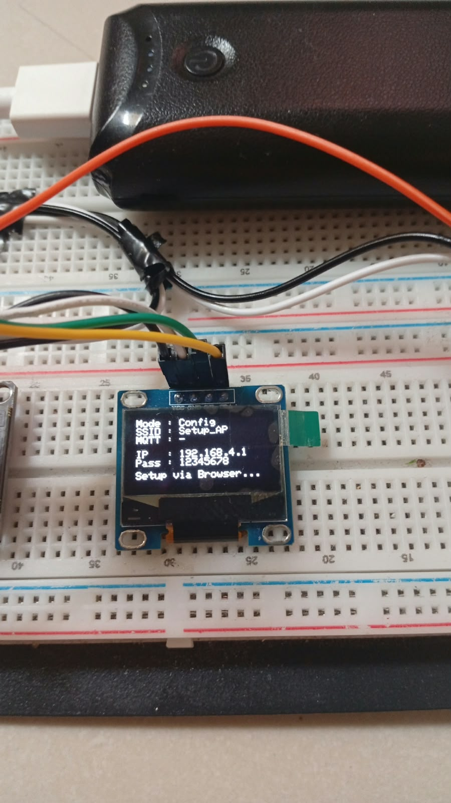

*Figure 4.12: OLED prompting the user to connect to the Setup AP ([ss/12-run-system-setup-or-config.jpeg](file:///d:/mygithub-research/iot/iot-monitor-temperatur/ss/12-run-system-setup-or-config.jpeg))*

**Technical Analysis & Context:**
Figure 4.12 shows the OLED screen when the device has no saved network credentials in its Non-Volatile Storage (NVS) or fails to connect to the stored network:
- The ESP32 switches into **Wi-Fi Access Point mode (`WIFI_AP`)** and boots a local HTTP web server on port 80.
- The OLED displays:
  - `Mode : Config`
  - `SSID : Setup_AP`
  - `IP : 192.168.4.1`
  - `Pass : 12345678`
  - `Setup via Browser...`
- The device informs any nearby user exactly how to connect and configure it without needing specialized software or cables.

---

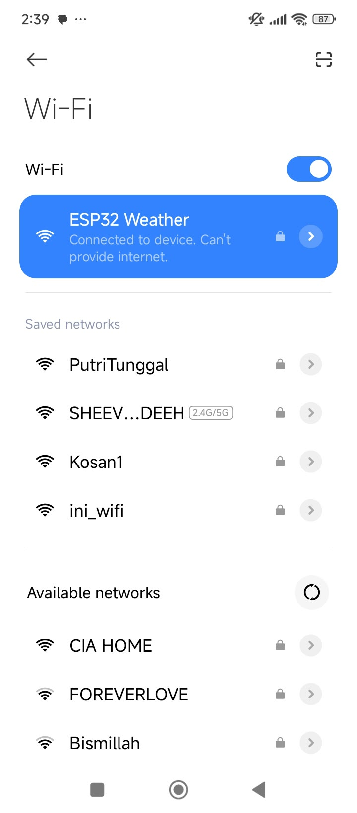

*Figure 4.13: Smartphone Wi-Fi settings detecting the ESP32 Weather hotspot ([ss/13-run-system-choose-sinyal-esp32-weather.jpeg](file:///d:/mygithub-research/iot/iot-monitor-temperatur/ss/13-run-system-choose-sinyal-esp32-weather.jpeg))*

**Technical Analysis & Context:**
Figure 4.13 shows the smartphone Wi-Fi scanning page:
- The phone discovers the access point named `ESP32 Weather` broadcast by the ESP32 chip.
- The system prompt indicates `Connected to device. Can't provide internet`, which is standard behavior for an isolated configuration portal.

---

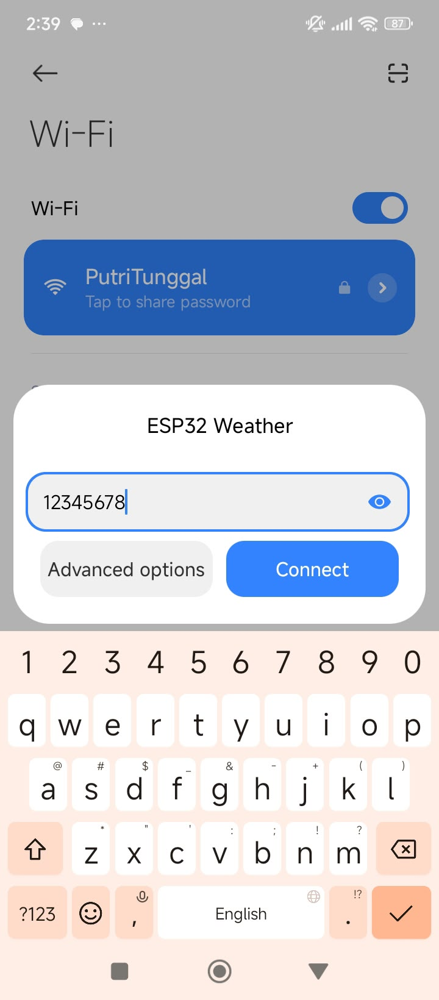

*Figure 4.14: Authenticating to the ESP32 hotspot with WPA2 security ([ss/14-run-system-choose-sinyal-esp32-weather-and-connected.jpeg](file:///d:/mygithub-research/iot/iot-monitor-temperatur/ss/14-run-system-choose-sinyal-esp32-weather-and-connected.jpeg))*

**Technical Analysis & Context:**
Figure 4.14 shows the password authentication prompt on the smartphone:
- The user inputs the pre-configured WPA2 network key: `12345678`.
- This ensures unauthorized users cannot alter the node's network parameters without physical access to the device screen.

---

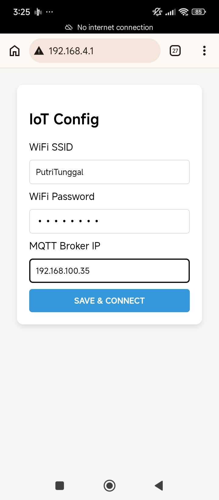

*Figure 4.15: Web configuration page hosted on ESP32 at 192.168.4.1 ([ss/15-run-system-input-server-mqtt-broker-and-connectivity-wifi.jpeg](file:///d:/mygithub-research/iot/iot-monitor-temperatur/ss/15-run-system-input-server-mqtt-broker-and-connectivity-wifi.jpeg))*

**Technical Analysis & Context:**
Figure 4.15 shows the smartphone browser visiting `http://192.168.4.1`:
- The ESP32's `ESPAsyncWebServer` serves a responsive, clean configuration page titled **IoT Config**.
- The form provides three input fields:
  1. **WiFi SSID:** Set to local Wi-Fi network `PutriTunggal`.
  2. **WiFi Password:** The secret WPA passphrase for the home/office router.
  3. **MQTT Broker IP:** Set to `192.168.100.35` (the local IP address of the host computer running the Mosquitto Docker container).
- When the user taps **SAVE & CONNECT**, the ESP32 commits these strings permanently to its internal flash memory using the `Preferences` library and issues an automatic software reboot (`ESP.restart()`).

---

### 4.7 Telemetry Ingestion and Multi-Device Real-Time Monitoring

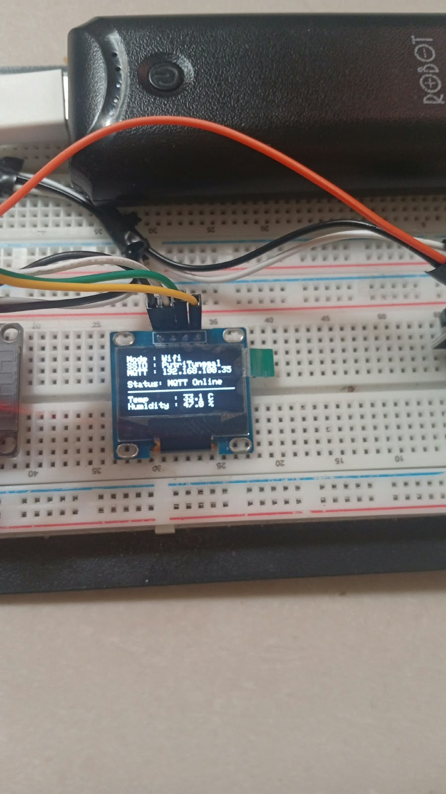

*Figure 4.16: OLED showing successful Wi-Fi link and MQTT Online status ([ss/16-run-system-conected-ke-mqtt-success.jpeg](file:///d:/mygithub-research/iot/iot-monitor-temperatur/ss/16-run-system-conected-ke-mqtt-success.jpeg))*

**Technical Analysis & Context:**
Figure 4.16 shows the OLED screen after rebooting with the new parameters:
- `Mode : Wifi`
- `SSID : PutriTunggal`
- `MQTT : 192.168.100.35`
- `Status: MQTT Online`
- `Temp : 33.1 C`
- `Humidity : 47.0 %`
The ESP32 successfully connected to the local Wi-Fi router, received an IP address via DHCP, established a TCP connection with the Mosquitto broker on port 1883, and started streaming telemetry packets every 2 seconds.

---

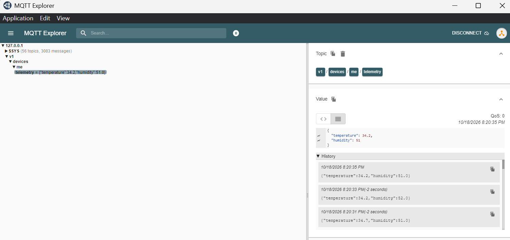

*Figure 4.17: MQTT Explorer validating real-time JSON telemetry stream ([ss/16-run-system-system-mqtt-broker-menerima-data.png](file:///d:/mygithub-research/iot/iot-monitor-temperatur/ss/16-run-system-system-mqtt-broker-menerima-data.png))*

**Technical Analysis & Context:**
Figure 4.17 captures live incoming traffic within MQTT Explorer connected to the Mosquitto broker:
- Under the topic tree `v1 / devices / me / telemetry`, packets are arriving every 2 seconds with QoS 0.
- Payload content is clean, formatted JSON:
  ```json
  {
    "temperature": 34.2,
    "humidity": 51.0
  }
  ```
- The history panel shows consecutive timestamps (`8:20:31 PM`, `8:20:33 PM`, `8:20:35 PM`), proving that data delivery is consistent and uninterrupted.

---

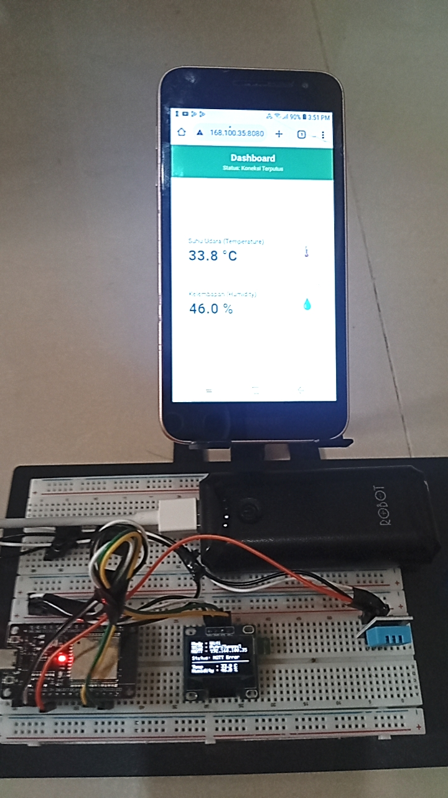

*Figure 4.18: Mobile smartphone displaying live sensor telemetry ([ss/17-run-system-system-data-temperatur-dan-humadity-tampil-di-hp.jpeg](file:///d:/mygithub-research/iot/iot-monitor-temperatur/ss/17-run-system-system-data-temperatur-dan-humadity-tampil-di-hp.jpeg))*

**Technical Analysis & Context:**
Figure 4.18 shows a smartphone mounted on a stand directly above the IoT node:
- The mobile browser points to `http://192.168.100.35:8080`.
- The web app connects via WebSockets to `ws://192.168.100.35:9001` and updates the display immediately:
  - **Suhu Udara (Temperature):** `33.8 °C`
  - **Kelembapan (Humidity):** `46.0 %`
- This confirms that any authorized smartphone connected to the same local area network can monitor environmental conditions in real time without needing to install dedicated native mobile apps.

---

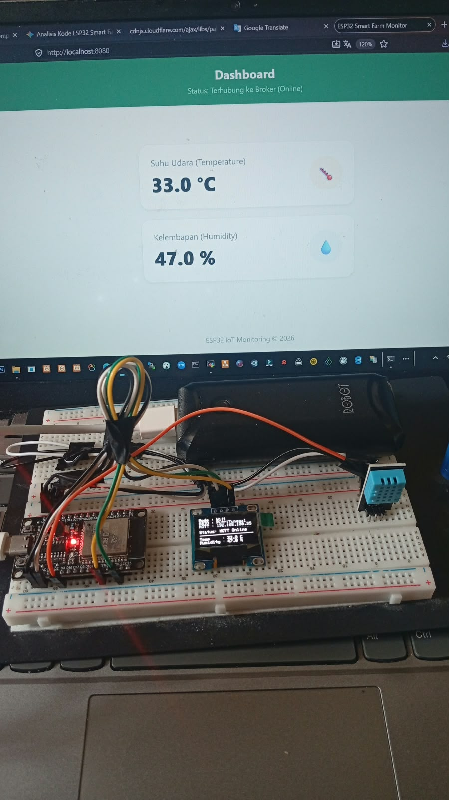

*Figure 4.19: Laptop dashboard and physical OLED display operating in complete synchronization ([ss/18-run-system-system-data-temperatur-dan-humadity-tampil-di-dashboard-laptop.jpeg](file:///d:/mygithub-research/iot/iot-monitor-temperatur/ss/18-run-system-system-data-temperatur-dan-humadity-tampil-di-dashboard-laptop.jpeg))*

**Technical Analysis & Context:**
Figure 4.19 shows the final complete view of the operational system:
- The laptop screen displays the web dashboard:
  - **Suhu Udara (Temperature):** `33.0 °C`
  - **Kelembapan (Humidity):** `47.0 %`
- In front of the keyboard, the physical OLED screen shows the exact same values: `Temp : 33.0 C`, `Humidity : 47.0 %`.
- This confirms end-to-end synchronization across the entire architecture: physical sensor $\rightarrow$ microcontroller $\rightarrow$ Wi-Fi $\rightarrow$ MQTT broker $\rightarrow$ WebSockets $\rightarrow$ client browsers.

---

## 5. How to Run the Project

### 5.1 Launching the Backend Server
1. Ensure **Docker Desktop** is installed and running on your server or host computer.
2. Clone or navigate to the repository directory:
   ```bash
   cd d:\mygithub-research\iot\iot-monitor-temperatur
   ```
3. Start the Docker services defined in [docker-compose.yaml](file:///d:/mygithub-research/iot/iot-monitor-temperatur/docker-compose.yaml):
   ```bash
   docker-compose up -d
   ```
4. Verify both containers are running:
   ```bash
   docker-compose ps
   ```
5. Test web dashboard availability by navigating to `http://localhost:8080` in your web browser.

---

### 5.2 Flashing Firmware to ESP32
1. Open the [main.ino](file:///d:/mygithub-research/iot/iot-monitor-temperatur/microcontroller-sensor-temperatur/main/main.ino) sketch in the **Arduino IDE** or **PlatformIO**.
2. Install the necessary libraries using the Library Manager:
   - `PubSubClient` by Nick O'Leary
   - `ESPAsyncWebServer` & `AsyncTCP`
   - `DHT sensor library` by Adafruit
   - `Adafruit SSD1306` & `Adafruit GFX Library`
3. Connect the ESP32 board to your computer via USB.
4. Select the board (`DOIT ESP32 DEVKIT V1` or generic `ESP32 Dev Module`) and the appropriate COM Port.
5. Click **Upload** to compile and flash the firmware.

---

### 5.3 Device Configuration and Operation
1. Power up the ESP32 using any 5V USB charger or power bank.
2. If it is the first boot, or if the Wi-Fi credentials need updating, the OLED will display:
   ```
   Mode : Config
   SSID : Setup_AP
   IP   : 192.168.4.1
   Pass : 12345678
   ```
3. On your phone or laptop, open Wi-Fi settings and connect to `ESP32 Weather` with password `12345678`.
4. Open your browser and navigate to `http://192.168.4.1`.
5. Enter your local Wi-Fi SSID, Wi-Fi Password, and the IP address of your Docker host machine running Mosquitto (e.g., `192.168.100.35`).
6. Click **SAVE & CONNECT**. The device will restart and automatically begin streaming live sensor telemetry to the MQTT broker.
7. Open `http://<your-server-ip>:8080` on any device to view the live dashboard.
8. *(Optional Reset):* To clear saved credentials, press and hold the button connected to `GPIO 0` for 3 seconds.

---

## 6. Key Learnings and Future Enhancements

### 6.1 Summary of Achievements
- **Robust IoT Architecture:** Successfully built a full three-tier architecture (Edge $\rightarrow$ Message Broker $\rightarrow$ Presentation).
- **Zero-Code Configuration:** Eliminated hardcoded credentials through an on-demand SoftAP captive portal.
- **Asynchronous Scalability:** By using MQTT over WebSockets, the backend supports high data throughput with low resource utilization.
- **Cross-Platform Compatibility:** The web dashboard functions consistently on desktop computers, laptops, tablets, and smartphones without native app installations.

### 6.2 Future Improvements
- **Time-Series Data Persistence:** Integrate **InfluxDB** or **TimescaleDB** to store historical telemetry data.
- **Historical Charting:** Add charting capabilities (such as Chart.js or Grafana) to visualize temperature trends over 24-hour and 7-day cycles.
- **Automated Alerts and Thresholds:** Implement automated notification hooks (via Telegram bot or email) to notify operators if temperature or humidity exceeds safe operating limits.
- **Security Hardening:** Add TLS encryption (`mqtts://` on port 8883 and `wss://` on port 9001) alongside client authentication tokens for public internet deployment.

---

*ESP32 IoT Temperature & Humidity Monitoring Project &copy; 2026.*
